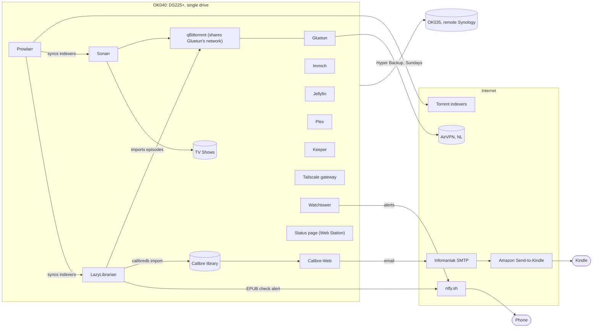

# synology-nas

Configuration, Compose projects and working notes for **OK040**, a Synology DS225+ (DSM 7.4.1, Container Manager) that runs one household's media, photos, books and backups. This repo is documentation plus the Compose files and helper scripts; the containers and their data live on the NAS. Secrets are never stored here (each project lists the names it needs).

It is written for one household NAS, not as a reusable product. Last reconciled with the running NAS on **2026-10-05**.

## At a glance

| Project | What |
|---|---|
| [host](projects/host/) | DSM-level setup: hardware and disk health, users and UIDs, shared folders, **network and services**, **scheduled tasks**, **backups**, **notifications (ntfy)**, **automation outside Docker**, open items, rebuild order. **Start here to rebuild.** |
| [gluetun-qbittorrent](projects/gluetun-qbittorrent/) | qBittorrent, Prowlarr, Sonarr and LazyLibrarian; torrent traffic is routed through Gluetun with a hard kill switch; the Kindle EPUB check and `fix-epub`. |
| [calibre-web](projects/calibre-web/) | Calibre-Web front end for the Calibre library, kepubify workaround, email to Kindle. |
| [immich](projects/immich/) | Immich photo management (four containers, version pinned) and its backup plan. |
| [jellyfin](projects/jellyfin/) | Jellyfin media server, read-only alongside Plex: Music and Audiobooks. |
| [keeper](projects/keeper/) | Keeper Markdown notes service, Tailscale-only, digest-pinned. |
| [watchtower](projects/watchtower/) | Image update reporting and selective auto-update, with ntfy notifications. |
| [tailscale-gateway](projects/tailscale-gateway/) | The NAS's Tailscale node (container, no Compose file on the NAS). |
| [tailscale-access](projects/tailscale-access/) | Tailscale access policy notes: how OK040 and the remote backup target OK035 are reached. |
| [status-page](projects/status-page/) | The Web Station homepage and the script that feeds its status section. |

## Where to reach things

The gateway page `http://100.126.55.95/` (Tailscale address; the NAS's LAN address is `192.168.178.110`) links to each service. What listens, and who can reach it (checked 2026-10-05):

| Port | Service | Reachable from |
|---|---|---|
| 80 / 443 | Web Station homepage (nginx) | LAN and Tailscale |
| 5000 / 5001 | DSM (HTTP / HTTPS) | LAN and Tailscale |
| 9022 | SSH (`ssh ok040`; **key-only**) | LAN and Tailscale |
| 445 / 139 | SMB (shares, Time Machine) | LAN and Tailscale |
| 32400 | Plex | LAN and Tailscale |
| 8096 | Jellyfin | LAN and Tailscale |
| 2283 | Immich | LAN and Tailscale |
| 8083 | Calibre-Web | LAN and Tailscale |
| 5299 | LazyLibrarian | LAN and Tailscale |
| 8080 | qBittorrent Web UI (published by Gluetun) | LAN and Tailscale |
| 8989 / 9696 | Sonarr / Prowlarr | LAN and Tailscale |
| 8766 | Keeper | Tailscale address only |
| 8000 | Gluetun control server | the NAS itself only |

More detail, including the DSM-internal ports, is in [host → Network and services](projects/host/README.md#network-and-services).

## What runs when

All times are the NAS's local time (Europe/Amsterdam). Detail and the scripts are in [host → Scheduled tasks](projects/host/README.md#scheduled-tasks-control-panel--task-scheduler).

| When | What |
|---|---|
| At boot | `Start Gluetun stack` (`start-stack.sh`) |
| Every 10 minutes | LazyLibrarian post-processor (imports finished books) |
| Every 6 hours | Watchtower update check |
| Hourly at :30 | `status-page-refresh` |
| Daily 00:00 | Security Advisor daily report |
| Daily 02:00 | Immich database dump; `Notes Daily Copy` |
| Saturday 01:00 | SMART quick test |
| First Saturday, 02:00 | SMART extended test (about 13 hours) |
| Sunday 00:15 / 09:00 | Hyper Backup "Timemachine Homes": backup / integrity check |
| Sunday 03:13 | Security Advisor scan |
| Sunday 12:15 / 21:00 | Hyper Backup "Media Docker": backup / integrity check |
| Wednesday 05:40 | DSM auto update |
| 1st of the month 00:00 | Security Advisor monthly report |

## Access and accounts

Admin work happens over **SSH on port 9022** as `master` (key login only; if the key is lost, DSM's Task Scheduler has a rescue task) and in DSM on port 5000; both are reachable from the LAN and over Tailscale, and nothing is forwarded from the internet (QuickConnect is off, no UPnP forwards). The built-in `admin` and `guest` accounts are disabled; `joost` is the personal account; `calibre` and `downloader` are service accounts whose UIDs the containers rely on. Details: [host → Access and accounts](projects/host/README.md#access-and-accounts) and [host → Users](projects/host/README.md#users).

## Backups, in one paragraph

OK040 has **one drive and no RAID**. The only copy that survives a disk failure is the **Sunday Hyper Backup to OK035**, a remote Synology that is **only powered on Sundays**; the copy is unencrypted. Immich also writes its own nightly database dump. The details, gaps and the plan to add a third copy are in [host → Backups](projects/host/README.md#backups) and [immich → Backups](projects/immich/README.md#backups).

## Notifications and outside accounts

Phone alerts use **ntfy** (one private topic, shared by Watchtower and the Kindle EPUB check); see [host → Notifications](projects/host/README.md#notifications-ntfy). Things that live outside the NAS: AirVPN (VPN and forwarded port), Infomaniak (mailbox and SMTP device password used by Calibre-Web), Amazon (Send-to-Kindle approved senders), ntfy.sh, the Tailscale admin console (the access policy), and the remote Synology OK035. Secret names (never values) are listed in [host → Secrets](projects/host/README.md#secrets-names-only-values-are-not-stored-here).

## Known hazards and open items

What to do next is in [TODO.md](TODO.md); the wider list is [host → Open items](projects/host/README.md#open-items-2026-10-05). The ones that can bite:

- Single drive, no RAID; backups unencrypted; no restore ever tested.

## Not in this repo

The Tailscale access policy and key settings (admin console); Hyper Backup's own task store (its settings are copied into the host README); Plex's configuration (it lives in the `PlexMediaServer` share, which the backup covers); every secret; and NAS-only files: `~/ansible.retired-2026-10-05` (an unused, retired Ansible setup), `~/keeper-deploy`, `/volume1/docker/BACKUP-INFRA-TODO.md`, `/volume1/docker/status-page/NOTES.md`.

## How this repo is kept

One project per folder under `projects/`, each with its own README; changes go in `CHANGELOG.md` (where the project has one). Commits are small and describe why. The remote is a **private** repository on Codeberg (`okkingaj/synology-nas`). Apply Compose files to the NAS by piping them through SSH (`ssh ok040 'cat > …' < file`), because the SFTP subsystem is off.
